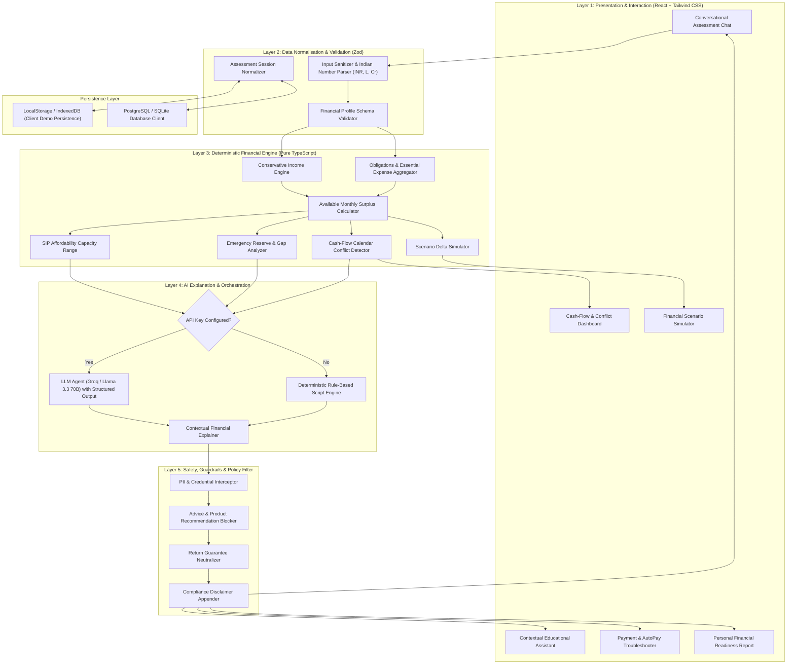
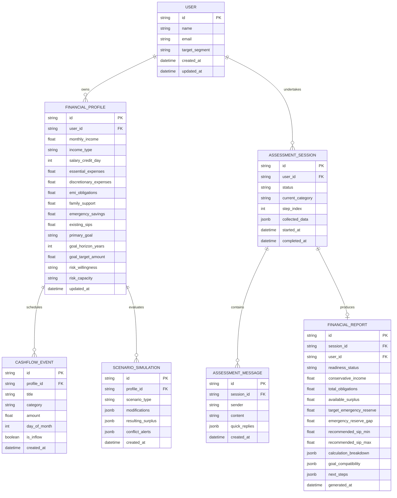
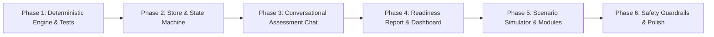

# GROWW SIP FIT — SYSTEM ARCHITECTURE & TECHNICAL SPECIFICATION
**AI-Powered Financial Readiness & SIP Continuity Platform**
*Document Version: 1.0.0 | Target Environment: Node.js / React / TypeScript*

---

## 1. Executive Summary & Core Principles

### 1.1 Purpose
**Groww SIP Fit** is an intelligent financial planning and investment readiness layer built to assist first-time mutual fund Systematic Investment Plan (SIP) investors (primarily ages 22–35). Rather than driving arbitrary investment volume, SIP Fit evaluates financial stability, cash-flow predictability, emergency liquidity, and debt commitments to determine whether a recurring investment is genuinely sustainable.

### 1.2 Non-Negotiable Architectural Principles
1. **Separation of Deterministic Calculations and AI Reasoning**: All financial values (surplus, affordability range, reserve gap, cash-flow conflicts) are computed by a pure, deterministic calculation engine. LLMs never invent, estimate, or hallucinate financial numbers.
2. **Deterministic Fallback (Zero-API-Key Operation)**: The complete platform must operate autonomously without requiring an active LLM API key. If no key is configured, a rule-based deterministic conversational agent takes over seamlessly.
3. **Guardrails & Compliance Safety**: Under no circumstance does the system recommend specific mutual fund schemes, stocks, or promise market returns. It remains strictly an educational and affordability assessment tool.
4. **Zero Sensitive PII Ingestion**: The system explicitly forbids capturing or storing PAN, OTPs, bank passwords, or raw account numbers.
5. **Traceable Explanations**: Every qualitative recommendation or readiness status shown to the user must link directly to an explicit formula, assumption, and validated user input.

---

## 2. High-Level System Architecture

The system follows a strict **5-Layer Architecture**, ensuring decoupling between user interaction, AI synthesis, deterministic business logic, and persistence.



---

## 3. The 5-Layer Detailed Breakdown

### Layer 1: Presentation & Interaction Layer
Built with modern React (SPA / Next.js) and Tailwind CSS with a clean, mobile-first Groww-inspired theme (clean whites, light neutrals, Groww emerald green accents `#00D09C`, dark readable typography `#1E222B`, rounded cards, smooth transitions).
- **Conversational Assessment Stepper**: Step-by-step chat UI presenting single questions with quick-reply pills, currency text boxes, and editability of prior answers.
- **Readiness Report View**: Visual gauges for monthly surplus, reserve gap, risk profile radar/meters, and indicative SIP capacity cards.
- **Interactive Cash-Flow Calendar**: Visual monthly timeline plotting salary date against rent, EMIs, utility bills, and target SIP debit dates with real-time conflict highlights.
- **Interactive Scenario Simulator**: Interactive range sliders (income drop %, rent bump, emergency expense lump sum, delayed salary days) updating metrics in <16ms.
- **Contextual Payment Assistant**: Interactive troubleshooter for AutoPay failures, mandate delays, and bank balance mismatch scenarios.

### Layer 2: Data Normalisation & Validation Layer
All conversational or form inputs pass through strict Zod schemas before touching calculations:
- **Currency Normalizer**: Accepts `"25k"`, `"25,000"`, `"2.5L"`, `"2,50,000"`, converting them to integer rupees.
- **Date Normalizer**: Handles ordinal day of month (e.g. `1st` to `31st`).
- **Profile Segment Classifier**: Classifies users into Profile A (Salaried fixed), Profile B (Salaried variable), Profile C (Freelancer/Self-employed), or Profile D (Family dependent/heavy debt).

### Layer 3: Deterministic Financial Calculation Engine
This is a standalone, 100% unit-tested TypeScript library without external dependencies.

#### A. Income Computation
```typescript
if (incomeType === 'variable') {
  // Conservative baseline: never use the high month
  conservativeMonthlyIncome = Math.min(typicalMonthIncome, lowMonthIncome * 1.1);
} else {
  conservativeMonthlyIncome = takeHomeSalary + regularOtherIncome;
}
```

#### B. Obligations & Recurring Commitments
$$\text{Total Monthly Obligations} = \text{Rent} + \text{Groceries} + \text{Utilities} + \text{Transport} + \text{Healthcare} + \text{Insurance} + \text{EMIs} + \text{Family Support} + \text{Existing SIPs} + \text{Discretionary Minimum}$$

#### C. Available Monthly Surplus
$$\text{Available Surplus} = \text{Conservative Monthly Income} - \text{Total Monthly Obligations}$$

#### D. Emergency Reserve & Reserve Gap
$$\text{Target Reserve} = \text{Essential Monthly Expenses} \times \text{Reserve Months (default 3 to 6)}$$
$$\text{Reserve Gap} = \max(0, \text{Target Reserve} - \text{Current Accessible Liquid Savings})$$
$$\text{Planned Monthly Reserve Contribution} = \text{Reserve Gap} > 0 ? \min(\text{Available Surplus} \times 0.30, \frac{\text{Reserve Gap}}{12}) : 0$$

#### E. Indicative SIP Contribution Capacity
$$\text{Uncommitted Surplus} = \text{Available Surplus} - \text{Planned Monthly Reserve Contribution} - \text{Buffer for Irregular Expenses (10\%)}$$
$$\text{Indicative SIP Range} = \begin{cases} 
  [0, 0] & \text{if } \text{Uncommitted Surplus} \le 0 \\
  [\text{Round}_{500}(\text{Uncommitted Surplus} \times 0.6), \text{Round}_{500}(\text{Uncommitted Surplus})] & \text{if } \text{Uncommitted Surplus} > 0
\end{cases}$$

#### F. Readiness Tier Classification Matrix
| Condition | Classification | Visual Badge | Guidance |
| :--- | :--- | :--- | :--- |
| Surplus $> 0$, Reserve Gap $= 0$, Debt-to-Income $< 35\%$ | **Ready for further SIP consideration** | Emerald Green | Safe to allocate within calculated range |
| Surplus $> 0$, but Surplus $< 15\%$ Income OR High EMIs | **Limited flexibility** | Amber Yellow | Recommend conservative lower bound |
| Reserve Gap $> 3\times$ Monthly Expenses OR Surplus $\le 0$ | **Liquidity needs attention** | Coral Red | Build emergency fund before recurring lock-in |
| Missing critical income, obligations, or debt data | **More information required** | Slate Gray | Prompt user to complete specific missing items |

#### G. Cash-Flow Conflict Algorithm
A date-based interval check checks balance drawdown between day 1 and 31:
$$\text{Balance}(t) = \text{Opening Balance} + \sum \text{Income}(t) - \sum \text{Obligations}(t) - \text{SIP}(t)$$
If $\text{Balance}(t) < \text{Safety Buffer (e.g. ₹5,000)}$ on or within 3 days prior to the SIP debit date, a **Cash-Flow Pressure Warning** is generated with suggested date adjustment (e.g. *"Move SIP debit date 3 days after salary credit"*).

---

### Layer 4: AI Orchestration & Explanation Layer
This layer translates calculated deterministic numbers into empathetic, crystal-clear natural language.

1. **Dual-Mode Adapter Pattern**:
   ```typescript
   export interface IConversationEngine {
     generateReply(session: AssessmentSession, userMessage: string): Promise<EngineReply>;
     generateReportExplanation(report: FinancialReport): Promise<ReportExplanation>;
     answerEducationalQuery(query: string, context: FinancialProfile): Promise<string>;
     troubleshootPayment(issue: PaymentIssue): Promise<PaymentGuidance>;
   }
   ```
2. **LLM Implementation (`GroqConversationEngine`)**:
   - Uses Groq Cloud API (`llama-3.3-70b-versatile` or `llama-3.1-8b-instant`) via `groq-sdk` or OpenAI-compatible endpoint.
   - Ultra-low latency inference with strict JSON schema definition.
   - Temperature: `0.1` (low variance, factually grounded).
   - Injects the deterministic calculation results into the system prompt as immutable truth.
3. **Fallback Implementation (`DeterministicFallbackEngine`)**:
   - Uses a finite-state machine (FSM) traversing Categories A through G.
   - Context-aware templating engine: generates personalized text based on calculated variables.
   - Ensures 100% functionality when offline or without an API key.

### Layer 5: Safety, Guardrails & Policy Filter
Intercepts every response before rendering:
- **Product Recommendation Filter**: Regex and embedding check for mutual fund scheme names (e.g. *"Parag Parikh Flexi Cap"*, *"HDFC Top 100"*, *"Nifty 50 ETF"*). If detected, replaces with generic asset class terms (*"diversified equity funds"*, *"liquid funds"*).
- **Return Guarantee Filter**: Replaces any speculative claims (*"you will get 15%"*) with standard regulatory language (*"equity investments are subject to market risks"*).
- **Credential & PII Redactor**: Automatically sanitizes accidental inputs resembling 10-digit PAN, 12-digit Aadhaar, 16-digit Card numbers, or OTP tokens.
- **Mandatory Regulatory Disclaimer**: Injects footer: *"Groww SIP Fit is a financial readiness decision aid and educational simulator. It does not provide SEBI-registered investment advice or guarantee future returns."*

---

## 4. Comprehensive Data Model & Schemas

### 4.1 Entity Relationship Diagram



### 4.2 TypeScript Domain Definitions
```typescript
export type IncomeType = 'salaried_fixed' | 'salaried_variable' | 'freelance_self_employed' | 'unemployed';

export type ReadinessTier = 
  | 'READY' 
  | 'LIMITED_FLEXIBILITY' 
  | 'LIQUIDITY_NEEDS_ATTENTION' 
  | 'MORE_INFO_REQUIRED';

export interface FinancialProfile {
  id: string;
  userId: string;
  income: {
    monthlyTakeHome: number;
    type: IncomeType;
    creditDay: number; // 1 - 31
    variableLowMonth?: number;
    variableHighMonth?: number;
    otherReliableIncome: number;
    isStableLast6Months: boolean;
  };
  expenses: {
    rent: number;
    groceriesUtilities: number;
    transportHealthcare: number;
    familySupport: number;
    discretionary: number;
    otherRecurring: number;
  };
  liabilities: {
    activeEmis: number;
    creditCardDebt: number;
    upcomingLargeCommitments: number;
  };
  savings: {
    accessibleEmergencyFund: number;
    reserveMonthsTarget: number; // 3 to 6
  };
  existingInvestments: {
    activeSipTotal: number;
    otherRecurringInvestments: number;
  };
  goal: {
    purpose: string;
    targetAmount: number;
    horizonYears: number;
    alreadySaved: number;
  };
  risk: {
    willingness: 'conservative' | 'moderate' | 'aggressive';
    capacity: 'low' | 'moderate' | 'high';
    marketUnderstanding: 'beginner' | 'intermediate' | 'experienced';
  };
}
```

---

## 5. UI/UX Architecture & Screen Navigation

### 5.1 Route Hierarchy
- `/` — **Landing Page**: Value proposition, profile switchers (Demo User A/B/C/D), entry to Assessment.
- `/assess` — **Conversational Readiness Assessment**:
  - Interactive progressive chat stepper covering Categories A through G.
  - Quick-reply chips, inline currency input, and historical answer modification.
- `/report` — **Personal Financial Readiness Report**:
  - Financial summary cards, readiness status badge, SIP affordability range.
  - Goal feasibility timeline & emergency reserve gauge.
- `/dashboard` — **Financial Continuity & Cash-Flow Dashboard**:
  - Monthly surplus tracking, cash-flow calendar, conflict warnings.
  - Expense & obligation breakdown charts.
- `/simulator` — **Financial Scenario Simulator**:
  - Sliders for delayed salary, rent spike, income dip, emergency expense shock.
  - Instant re-calculation and comparative side-by-side delta.
- `/education` — **Contextual AI Investment Coach**:
  - Interactive Q&A for SIP fundamentals, NAV, compounding, market volatility.
- `/payment-help` — **Contextual Payment & AutoPay Assistant**:
  - Diagnostic flow for mandate issues, failed transactions, bank debits.
- `/profile` — **Profile & Data Management**:
  - Edit financial numbers, reset demo state, wipe local session.

### 5.2 Responsive & Fintech Styling System
- **Color Palette**:
  - Primary Brand: `#00D09C` (Groww Green)
  - Dark Neutral / Headings: `#1E222B`
  - Body Text: `#44475B`
  - Subtle Background: `#F8FAFC`
  - Card Surface: `#FFFFFF` with border `#E5E7EB`
  - Warning/Amber: `#FFB800`
  - Danger/Deficit: `#EB5757`
  - Blue/Informative: `#4A90E2`
- **Typography**: Inter / Outfit sans-serif system with clean weights (400, 500, 600, 700).
- **Number Formats**: Standard Indian numbering system with ₹ symbol (e.g., `₹25,000`, `₹1,50,000`, `₹12.50 L`).

---

## 6. Implementation Plan & Technology Stack

### 6.1 Technology Stack Selection
- **Framework**: React 18+ with TypeScript & Vite (lightning-fast HMR, lightweight client bundle).
- **UI Components & Styling**: Tailwind CSS, Lucide React icons, Radix UI primitives.
- **Charts & Visualizations**: Recharts (smooth, accessible SVG charts for cash flows and reserve gaps).
- **State Management & Persistence**: Zustand with `persist` middleware (syncs to LocalStorage for zero-setup instant demo persistence).
- **Form & Data Validation**: Zod.
- **AI Integration**: Unified AI Service Client supporting Groq API (`groq-sdk` with `llama-3.3-70b-versatile` / `llama-3.1-8b-instant`) with automatic fallback to `DeterministicFallbackEngine`.
- **Testing**: Vitest for deterministic calculation unit tests.

### 6.2 Phased Execution Roadmap



1. **Phase 1: Core Financial Calculation Engine**:
   - Implement `incomeCalculator.ts`, `obligationsCalculator.ts`, `surplusCalculator.ts`, `reserveCalculator.ts`, `sipCapacityCalculator.ts`, and `cashflowConflictDetector.ts`.
   - Comprehensive Vitest unit test suite validating edge cases (zero income, high debt, negative surplus, variable income conservatively handled).

2. **Phase 2: Data Store & Demo Profiles**:
   - Create Zustand store with complete persistence.
   - Seed Profile A (Salaried early-career), Profile B (Variable incentive earner), Profile C (Freelancer), and Profile D (Family dependent).
   - Configure Sample Demonstration User (Buying a house, 3–5 year horizon).

3. **Phase 3: Conversational Assessment Flow**:
   - Build dual-mode chat engine (`GroqConversationEngine` + `DeterministicFallbackEngine`).
   - Implement question sequence from Category A (Goals) through Category G (Risk & Knowledge).
   - Implement inline editing and response history.

4. **Phase 4: Financial Readiness Report & Cash-Flow Dashboard**:
   - Build the 5-section Financial Readiness Report with readiness badges and calculated capacity.
   - Build Cash-Flow Calendar with conflict warnings.
   - Render income vs. expense breakdown and emergency fund progress charts.

5. **Phase 5: Scenario Simulator & Education/Payment Troubleshooter**:
   - Build 6 interactive simulation scenarios (delayed salary, rent hike, medical shock, etc.).
   - Build Contextual AI Education assistant and Payment Help troubleshooter with mock diagnostic trees.

6. **Phase 6: Guardrails, Accessibility & Final Verification**:
   - Implement advice/recommendation blockers and PII scrubbers.
   - Verify all 18 Acceptance Criteria.

---

## 7. Acceptance Criteria Verification Matrix

| ID | Criterion | Implementation Component | Verification Method |
| :--- | :--- | :--- | :--- |
| **AC-01** | Start financial assessment | `AssessmentChat.tsx` | New user initiates assessment on `/assess` |
| **AC-02** | All financial questions asked | `assessmentQuestions.ts` | Completes Categories A through G sequentially |
| **AC-03** | Remembers earlier responses | `useAssessmentStore.ts` | State persisted across questions |
| **AC-04** | User can edit responses | `ChatHistoryItem.tsx` | Click "Edit" on prior bubble updates store and re-branches |
| **AC-05** | Engine processes answers | `calculateReadiness.ts` | Pure functions consume normalized state |
| **AC-06** | Report from real calculations | `FinancialReportView.tsx` | All report figures trace back to calculation breakdown |
| **AC-07** | Missing data identified, not invented | `validateProfile.ts` | Missing inputs trigger `'MORE_INFO_REQUIRED'` |
| **AC-08** | Dashboard displays calculated values | `FinancialDashboard.tsx` | Displays real calculated surplus and reserve target |
| **AC-09** | Add, edit, remove recurring expenses | `ExpenseManager.tsx` | Interactive CRUD in Dashboard |
| **AC-10** | Simulates salary delay, reduced income, shock | `ScenarioSimulator.tsx` | Interactive sliders for Scenarios A–F |
| **AC-11** | Simulation recalculates immediately | `scenarioEngine.ts` | State changes re-render deltas in $<16$ms |
| **AC-12** | AI explains from engine output | `explanationService.ts` | Engine calculations passed into explanation context |
| **AC-13** | AI cannot invent financial amounts | `promptTemplates.ts` | System prompt forbids inventing unpassed numbers |
| **AC-14** | No specific fund/stock recommendations | `safetyGuardrails.ts` | Guardrail filter blocks scheme name patterns |
| **AC-15** | Mobile and desktop responsive | Tailwind Layouts | Tested on mobile viewport ($375\text{px}$) and desktop ($1440\text{px}$) |
| **AC-16** | Data persists after page refresh | Zustand `persist` | Session survives browser reload via LocalStorage |
| **AC-17** | User can reset/delete demo profile | `ProfileSettings.tsx` | "Reset Demo Profile" restores initial state |
| **AC-18** | Works without API key | `fallbackEngine.ts` | Seamless deterministic operation when `VITE_GROQ_API_KEY` is empty |

---

*Architectural Plan Approved for Implementation.*
